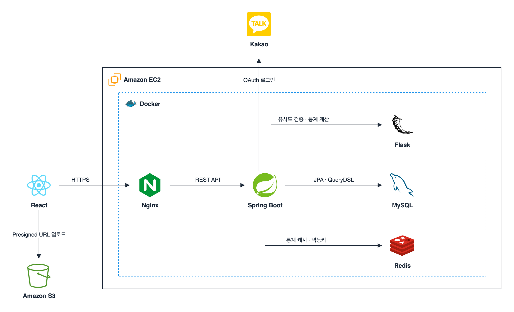

# Planet Rush

## 주제

-   사진 인증 기반 그룹 챌린지 서비스
-   2024.07 ~ 2024.08 | 6인 팀 | 백엔드

## 주요 기여

### 1. 동시 요청 환경의 데이터 정합성 확보

**문제**

-   챌린지(행성) 가입과 탈퇴 요청이 동시에 들어오면, 챌린지에 기록된 참여 인원이 실제 참여 정보와 어긋났습니다.
-   같은 요청이 중복으로 들어오면 그대로 두 번 처리되었습니다.

**해결**

-   비관적 락으로 정원 확인과 인원 갱신을 직렬화했습니다.
-   참여 정보 변경과 인원 갱신을 하나의 트랜잭션으로 묶었습니다.
-   Redis 멱등키로 동일한 요청의 중복 처리를 막았습니다.

**결과**

-   1,000명 동시 요청 시나리오에서 참여 인원 불일치 없이 처리되는 것을 확인했습니다.

### 2. 사진 인증 비동기 처리와 장애 대응

**문제**

-   인증 API가 이미지 유사도 판별 서버(Flask)를 동기 HTTP로 호출해, 판별 결과가 돌아올 때까지 요청 스레드가 대기했습니다.
-   외부 서버의 처리 시간과 네트워크 지연이 인증 API 응답 시간에 그대로 포함되었습니다.
-   판별 서버 호출이 일시적으로 실패하면 인증 요청도 함께 실패했습니다.

**해결**

-   인증 접수와 이미지 검사를 분리했습니다. 요청에는 접수 결과를 먼저 반환하고, 판별 서버 호출은 워커 스레드에서 수행합니다.
-   검사가 끝나면 Spring 내부 이벤트를 발행하고, 이벤트 리스너가 결과를 데이터베이스에 저장합니다.
-   판별 서버의 일시적 실패에는 지수 백오프 기반 재시도(최대 5회)를 적용했습니다.

**결과**

-   인증 API 응답 시간을 4초에서 0.3초로 단축했습니다.

**이후 개선**

-   워커 스레드 방식은 서버가 종료되면 진행 중인 검사가 유실됩니다. 이를 보완하는 Outbox 패턴과 Redis Streams 기반 발행 경로를 추가했고, 설정(`verification.publisher.type`)으로 선택할 수 있습니다. 기본값은 워커 스레드 방식입니다.

## Architecture

  

